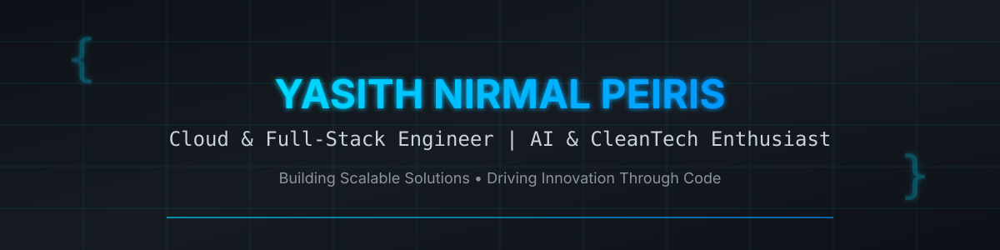

<div align="center">
  
</div>

[](https://git.io/typing-svg)

<div align="center">
  
[](https://www.linkedin.com/in/yasith-nirmal-peiris-28491b346)
[](https://www.instagram.com/yasith_88)
[](https://www.facebook.com/share/14FdYii2RMi/)
[](https://github.com/yasithnirmal88)

</div>

##  About Me

```bash
$ whoami
> Yasith Nirmal Peiris | Developer & Student @ KDU

$ cat about.md
> Building AI-based waste-sorting systems to drive clean tech innovation
> Passionate about scalable web apps, intelligent automation & solving real problems
> Turning ideas into elegant, functional solutions with clean code

$ cat stack.json
{
  "focus": ["Full-Stack Development", "AI/ML", "CleanTech", "Automation"],
  "currently_learning": ["System Design", "Cloud Architecture", "AI Integration"],
  "goal": "Building tech that makes the world cleaner and smarter"
}
```

## 🛠️ Tech Stack

### Frontend


### Backend & Database


### Cloud, DevOps & Tools


## 🚀 Featured Projects

<div align="center">

[](https://github.com/yasithnirmal88/medicheck2)
[](https://github.com/yasithnirmal88/scam-sentry)

[](https://github.com/yasithnirmal88/fake-job-analyzer)
[](https://github.com/yasithnirmal88/SupplyLinkLK)

</div>

<div align="center">
  <a href="https://github.com/yasithnirmal88?tab=repositories">
    
  </a>
</div>

## ✨ Interactive Components

### Contribution Skyline
A stunning 3D isometric contribution graph that transforms your GitHub activity into an animated skyline. Built with React, TypeScript, and Canvas for smooth performance.

- **Dual View Modes**: Switch between classic 2D heatmap and interactive 3D skyline
- **Smooth Animations**: Watch bars rise in a wave pattern as it morphs between views
- **Interactive**: Hover, click, orbit in 3D, and explore with keyboard navigation
- **Customizable**: Multiple color palettes, themes, and height scaling
- **Fully Responsive**: Works beautifully on desktop and mobile

> Add `contribution-skyline.tsx` to your `/components/ui` folder for use in React projects. Requires shadcn/ui with Tailwind CSS and TypeScript.

## 📊 GitHub Analytics

<div align="center">
  
  
</div>

<div align="center">
  
</div>

## 🐍 Contribution Snake

<div align="center">
  <picture>
    <source media="(prefers-color-scheme: dark)" srcset="https://raw.githubusercontent.com/yasithnirmal88/yasithnirmal88/output/github-contribution-grid-snake-dark.svg">
    <source media="(prefers-color-scheme: light)" srcset="https://raw.githubusercontent.com/yasithnirmal88/yasithnirmal88/output/github-contribution-grid-snake.svg">
    
  </picture>
</div>

## 🤝 Let's Connect & Collaborate

<div align="center">
  
I'm always open to interesting projects, collaborations, and opportunities to build impactful solutions!

[](mailto:yasithnirmal88@gmail.com)
[](https://www.linkedin.com/in/yasith-nirmal-peiris-28491b346)
[](https://github.com/yasithnirmal88)

</div>

<div align="center">
  
</div>

<div align="center">
  <i>⚡ "Code to create. Build to impact." ⚡</i>
</div>
## Hi there 👋

<!--
**yasithnirmal88/yasithnirmal88** is a ✨ _special_ ✨ repository because its `README.md` (this file) appears on your GitHub profile.

Here are some ideas to get you started:

- 🔭 I’m currently working on ...
- 🌱 I’m currently learning ...
- 👯 I’m looking to collaborate on ...
- 🤔 I’m looking for help with ...
- 💬 Ask me about ...
- 📫 How to reach me: ...
- 😄 Pronouns: ...
- ⚡ Fun fact: ...
-->
>>>>>>> 40ba93f819ddd6a8c4d0ec9f13a5ed8e84af38bf
